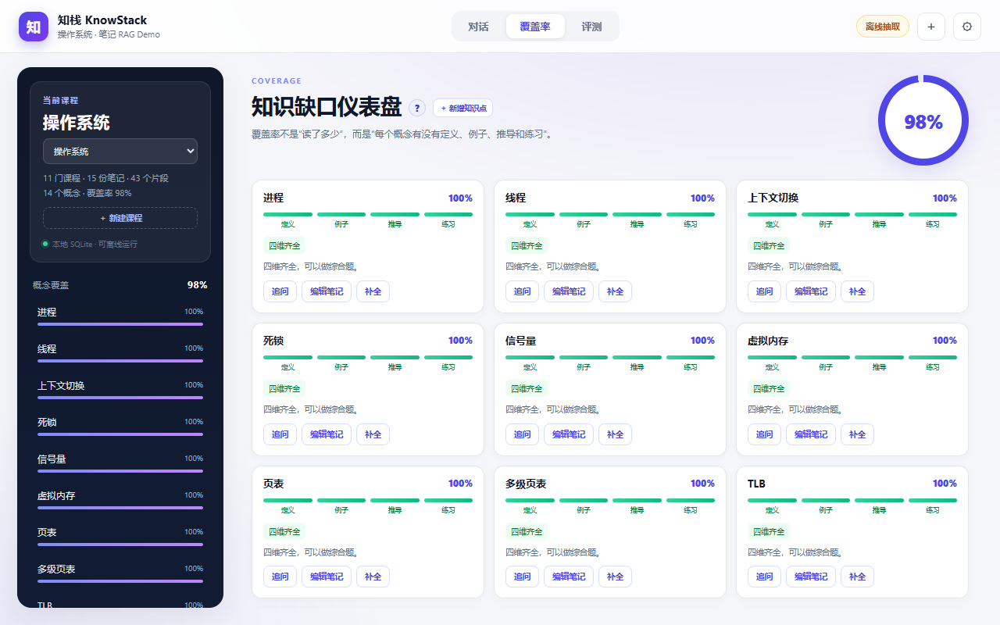
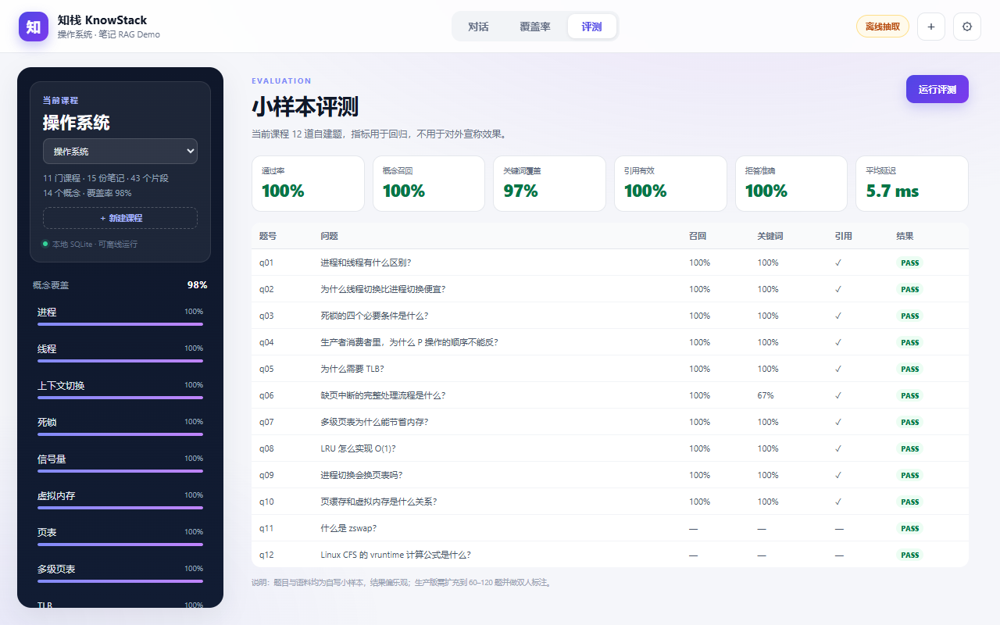
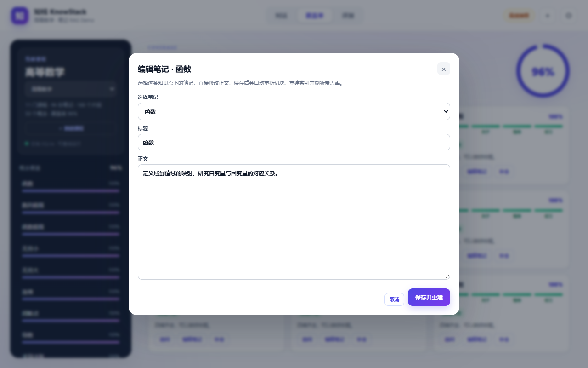
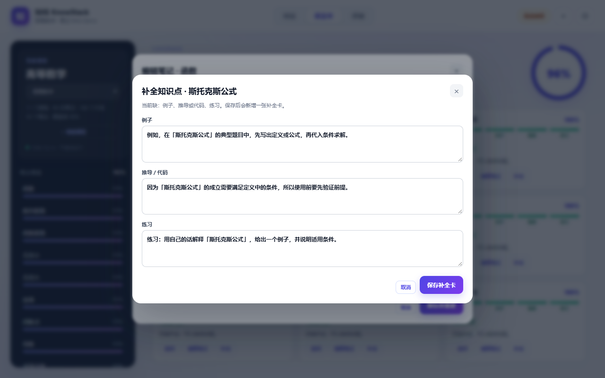

# 知栈 KnowStack · 课程笔记 RAG Demo

> 一个**能直接跑、能讲清楚、能写进简历**的 RAG 小项目：把你的课程笔记变成可检索、可引用、会指出缺口的问答助手。

- **多课程**：预置 11 门课，左侧可切换，也可新建课程
- **课程库**：操作系统 / 数据结构 + 高等数学、离散数学、数据结构与算法、计算机网络、数据库系统、软件工程、计算机组成原理、Java、Python，共 450 条定义 + 自动补全卡，课程覆盖率 ≥ 95%
- **零依赖**：只用 Python 标准库 + SQLite，`python server.py` 一条命令启动
- **可离线**：不配置任何 API Key 也能完整演示
- **可溯源**：回答由证据句拼接，逐句标 `[1]`，点击可看原文
- **有判断**：没有证据会拒答；笔记与教材冲突会并列提示；问“缺什么”会输出缺口诊断
- **可评测**：内置 16 题小样本回归，一键出指标

> 这是完整项目《计算机专业课笔记 RAG 智能知识库 Agent》的**简历版 Demo**。完整项目计划见 [`docs/项目开发计划书.md`](docs/项目开发计划书.md)。

---

## 截图


| 带引用的回答 | 笔记与教材冲突 |
|---|---|
|  |  |

| 知识缺口仪表盘 | 小样本评测 |
|---|---|
|  |  |

| 数据结构课程 | 追问「缺什么」 |
|---|---|
|  |  |


| 高等数学 · 50 条 | 问「洛必达法则」 |
|---|---|
|  |  |

---

## 30 秒启动

```powershell
cd knowstack-demo
python server.py
# 打开 http://127.0.0.1:8765
```

重置演示数据：

```powershell
python server.py --reset
```

或者：

```powershell
pwsh start.ps1
```

要求：Python 3.10+。不需要 `pip install`，不需要 Node，不需要 Docker。首次启动会自动生成 `data/demo.db`；重置演示数据用 `python server.py --reset`。

---

## 踩坑记录（面试可展开）

- **FTS5 没有中文分词**：最初中文几乎搜不到；改成字符 bigram 后召回正常，但“什么/怎么”带来假召回，于是加停用词表。
- **复习题污染回答**：复习题小节包含问题原句，BM25 分数很高，答案会把题目当答案；给 `exercise` 类型降权并从回答候选中剔除。
- **概念“顺带提一句”导致覆盖率虚高**：最初任何出现都建立链接；改为“标题命中或正文至少两次”，覆盖率一度从 80% 降到 62%，补内容后回到 67%。
- **引用卡片与正文不一致**：同一 chunk 有多句时，引用取了最后一句；改为按首次使用句生成 `quote`。

---

## 它做了什么

| 能力 | 实现 | 面试可讲点 |
|---|---|---|
| Markdown 笔记入库 | 解析 Markdown 二级标题，按小节切块 | 结构感知分块，保留章节路径 |
| 多课程 | 每门课独立文档、概念、检索与覆盖率 | 课程隔离，避免术语串味 |
| 中文检索 | SQLite FTS5 + 字符 bigram + 停用词 | FTS5 没有中文分词器，用 bigram 绕过 jieba 依赖 |
| 概念增强 | 每门课独立概念词表（OS 14 / DS 12 / 新课 50） | 用课程结构修正纯词面检索 |
| 可信回答 | 抽取式拼接，逐句引用，无证据拒答 | 不调用模型也能做到“不编造” |
| 冲突提示 | 笔记与教材的规则比对 | 把“用户语料可能错”当一等公民 |
| 缺口诊断 | 四维覆盖率；问「缺什么」输出缺项与补全建议 | 从“问答”走到“学习闭环” |
| 编辑笔记 | 覆盖率卡片「编辑笔记」→ 改正文 → 重切块、重建索引 | 改完立即影响检索与覆盖率 |
| 补全知识点 | 「补全」→ 补例子/推导/练习 → 新增补全卡 | 覆盖率实时上涨，补全卡可继续编辑 |
| 新增知识点 | 覆盖率页「＋ 新增知识点」→ 名称 + 定义 | 不用改代码就能扩库 |
| 小样本评测 | 16 题（OS 12 / DS 4） | 指标可复算，不靠感觉 |
| 可选 LLM | DeepSeek/OpenAI 兼容接口 | 配置 Key 即切换，提示词仍强制引用 |
| 增量导入 | 粘贴 Markdown；新课程按 `##` 标题自动抽概念 | 导入后立即可检索，覆盖率实时更新 |

### 四个关键设计

**1. 回答是“拼”出来的，不是“编”出来的**

离线模式下，系统只从命中的证据块中挑选句子，按 `结论 → 依据 → 缺口` 组织，每句带 `[n]`。没有证据就输出拒答三段式。这样即使没有大模型，也不会出现“看起来像真的”的幻觉。

**2. 概念是检索与统计的共同锚点**

同一套概念 ID 同时用于：检索加权、覆盖率统计、缺口排序、追问入口。避免“检索一套、统计另一套”。

**3. 冲突不是噪声，是学习信号**

演示语料故意在笔记里写错两处：

- “进程切换不会切换页表”
- “页表项有效位为 1 表示该页不在内存”

教材片段给出正确说法。提问时系统会并列双方原文、标注权威度，并建议以教材为准——这正是通用 RAG 容易放大的错误。

**4. “缺什么”要单独回答，不是答完就结束**

当问题里出现“缺什么 / 补什么 / 还差”时，系统会在正常回答后追加“笔记缺口”段：逐项对照定义、例子、推导、练习；如果四维齐全，也会给“补一道综合题 / 建立跨课程关联”的进阶建议，并返回缺口卡片。

### 补全示例：上下文切换

原来「上下文切换」缺例子和练习，覆盖率 55%。补了两小节：

- **例子**：同一进程内线程 A → B，保存寄存器、程序计数器、栈指针；切到另一个进程时，还要保存/恢复地址空间相关状态。
- **练习**：一次线程切换和一次进程切换分别保存哪些现场？为什么线程切换更便宜？

卡片覆盖率 55% → 100%。9 门新课在此基础上用「自动补全卡」把课程覆盖率推到 **95%+**，补全卡可以在「编辑笔记」里继续改写。

---

## 课程库

当前演示库共 **892 份笔记 / 1,772 个片段 / 476 个概念**：

| 课程 | 条数 | 来源 |
|---|---|---|
| 操作系统 | 4 份笔记 / 23 片段 | 人工精写，含冲突与覆盖率演示 |
| 数据结构 | 2 份 / 14 片段 | 人工精写，含栈、队列、快排等 |
| 高等数学 | 50 条定义 + 补全卡 | `seed_data/math.json` |
| 离散数学 | 50 条定义 + 补全卡 | `seed_data/discrete.json` |
| 数据结构与算法 | 50 条定义 + 补全卡 | `seed_data/ds_algo.json` |
| 计算机网络 | 50 条定义 + 补全卡 | `seed_data/network.json` |
| 数据库系统 | 50 条定义 + 补全卡 | `seed_data/database.json` |
| 软件工程 | 50 条定义 + 补全卡 | `seed_data/software.json` |
| 计算机组成原理 | 50 条定义 + 补全卡 | `seed_data/organization.json` |
| Java 程序设计 | 50 条定义 + 补全卡 | `seed_data/java.json` |
| Python 开发 | 50 条定义 + 补全卡 | `seed_data/python.json` |

9 门新课每条先是一张“定义卡”，再按缺失维度生成「补全卡」：例子、推导/代码、练习。**课程覆盖率统一 ≥ 95%**；补全卡在引用里标 `补全`，问答时不会拿模板补全卡当主要依据。

---

## 编辑、补全、新增知识点

覆盖率每张卡片有三个按钮：

- **追问**：跳到对话，问“解释 X，并指出缺什么”。
- **编辑笔记**：选择该知识点下的笔记，直接改标题/正文；保存后自动重切块、重建 FTS 索引、刷新覆盖率。
- **补全**：弹窗列出缺失维度，预填模板，保存后新增一张补全卡。

页面右上角还有 **「＋ 新增知识点」**：填名称 + 定义，立即生成概念和第一条笔记。

| 覆盖率 + 编辑入口 | 编辑笔记 |
|---|---|
|  |  |

| 补全缺失维度 |  |
|---|---|
|  | 保存后覆盖率实时上涨 |

相关 API：

```
GET  /api/notes?conceptId=...
PUT  /api/notes/{docId}        {title, text}
POST /api/concepts             {courseId, name, definition}
POST /api/concepts/{id}/fill   {example, derivation, practice}
```

---

## 怎么加新课程 / 新笔记

### 页面操作（推荐）

1. 左侧点「＋ 新建课程」，填课程名（如“计算机网络”）。
2. 右上角「＋」导入 Markdown。每个 `## 标题` 会切成一个小节；新课程会按标题**自动抽概念**。
3. 导入后：左侧概念、覆盖率、对话检索立即生效。
4. 想加评测：在 `eval/questions.json` 追加一条，`courseId` 填新课程 id（地址栏 `?course=...` 里那串）。

### 预置课程（写进仓库）

1. 在 `concepts.json` 的 `courses` 里加一门课：`{id, name, dir, concepts, conflicts}`。
2. 新建 `corpus/<dir>/*.md`，用 `## 小节标题` 组织内容。
3. `python server.py --reset` 重建。

### 注意

- 每门课独立：文档、概念、检索、覆盖率都按 `course_id` 隔离，术语不会串课。
- 自建课程的概念来自 `##` 标题，标题尽量写知识点名（如“三次握手”），不要写“第一节”“正文”。
- 新课程第一次导入会自动抽概念；后续再导入新小节，也会继续补概念。

---

## 评测结果

运行方式：页面「评测」→「运行评测」，或 `POST /api/eval/run`。评测只看当前课程。

**操作系统（12 题）**

| 指标 | 结果 | 说明 |
|---|---|---|
| 通过率 | 100% | 12/12 |
| 概念召回 | 100% | 命中证据覆盖期望概念 |
| 关键词覆盖 | 97% | 参考答案关键点命中 |
| 引用有效 | 100% | 引用块存在且引文可回溯 |
| 拒答准确 | 100% | 2 道“笔记未覆盖”全部拒答 |
| 平均延迟 | ~3 ms | 本机离线检索 |

**数据结构（4 题）**：通过 100%、概念召回 83%、关键词覆盖 100%、引用有效 100%、拒答准确 100%。

其余 9 门课暂时没有评测题，评测页会显示“当前课程还没有评测题”。

> 注意：这是 **16 道自建题、语料与题目同源** 的小样本结果，只用于回归和演示，不能对外宣称“RAG 准确率 100%”。生产版需要 60–120 题、双人标注与独立语料。

---

## 架构

```
浏览器（原生 HTML/CSS/JS，无构建）
        │  fetch JSON
        ▼
Python http.server（零依赖）
        │
        ├─ /api/state?course=os ─► 课程、概念、覆盖率、推荐问题
        ├─ /api/courses ─────────► 新建课程
        ├─ /api/ask ─────────────► rag.ask(courseId)
        │                           ├─ detect_concepts   课程内概念命中
        │                           ├─ search            FTS5 BM25 + 概念加权
        │                           ├─ 抽取式回答 + 引用
        │                           ├─ detect_conflicts  笔记/教材规则比对
        │                           └─ 缺口诊断（问“缺什么”时）
        │
        ├─ /api/ingest ──────────► 切块 → FTS5 → 概念链接（新课程自动抽概念）
        ├─ /api/eval/run ────────► 当前课程小样本回归
        └─ /api/settings ────────► 可选 LLM 配置（仅内存）
        │
        ▼
SQLite：courses / docs / chunks / chunks_fts / concepts / chunk_concepts
```

核心文件：

- [`rag.py`](rag.py)：分词、多课程检索、回答、冲突、覆盖率、评测
- [`server.py`](server.py)：HTTP 路由与静态资源
- [`static/app.js`](static/app.js)：课程切换、聊天、引用面板、覆盖率、评测
- [`corpus/os/`](corpus/os/)：4 份操作系统演示笔记（含 2 处故意错误）
- [`corpus/ds/`](corpus/ds/)：2 份数据结构演示笔记
- [`eval/questions.json`](eval/questions.json)：16 题评测集

---

## 5 分钟面试演示脚本

| 时间 | 动作 | 你要讲的话 |
|---|---|---|
| 0:00 | 打开首页 | “本地优先的课程笔记 RAG，11 门课，零依赖一条命令启动。” |
| 0:20 | 左侧切到「数据结构」 | “同一套链路，文档/概念/检索按课程隔离，术语不会串。” |
| 0:40 | 问“栈和队列有什么区别？” | “回答由证据句拼接，每个 [1] 都能点开原文。” |
| 1:20 | 切回「操作系统」，问“进程切换会换页表吗？” | “笔记写错了，教材是对的；系统并列两边，不替用户裁决。” |
| 2:00 | 问“什么是 zswap？” | “没有证据就拒答，并给出补笔记建议。” |
| 2:30 | 问“解释线程，并指出笔记缺什么” | “它会把定义/例子/推导/练习逐项对照，四维齐全也会给进阶建议。” |
| 3:10 | 切「覆盖率」 | “缺口按权重排序；点「?」看四维怎么算。” |
| 3:50 | 切「评测」跑当前课程 | “召回、引用、拒答都可复算；小样本只做回归，不吹效果。” |
| 4:10 | 覆盖率卡片「编辑笔记」/「补全」 | “改完正文自动重切块、重建索引；缺哪维补哪维，覆盖率实时变化。” |
| 4:35 | 左侧「＋ 新建课程」→ 导入 Markdown | “`##` 标题自动抽概念，立即可检索。” |
| 4:55 | 讲取舍 | “为什么不用向量库、为什么用 bigram、生产版怎么升级。” |

---

## 简历怎么写

> **知栈 KnowStack｜计算机专业课笔记 RAG 知识库 Demo（个人项目）**
>
> - 独立设计并实现面向计算机专业课笔记的 RAG 问答 Demo：Python 标准库 + SQLite FTS5 + 原生前端，零第三方依赖，一条命令启动。
> - 支持多课程隔离与新建课程：预置 11 门课 / 450 条定义卡，每门课独立文档/概念/检索/覆盖率；新课程按 `##` 标题自动抽概念，导入即可检索。
> - 实现覆盖率驱动的编辑闭环：自动补全缺失维度到 95%+，支持在页面直接编辑笔记、补例子/推导/练习、新增知识点，保存后立即重建索引。
> - 针对 FTS5 不支持中文分词的问题，设计字符 bigram + 停用词过滤 + 概念加权重排，解决通用问句的假召回；内置 16 题回归集，引用有效 100%、拒答准确 100%（小样本）。
> - 把“可信”做成工程约束：回答仅由证据句拼接、逐句编号、无证据拒答；对笔记与教材的定义/数值冲突并列提示，避免错误笔记被模型放大。
> - 实现概念四维覆盖率与缺口追问，把“问答”扩展为“诊断—补全”的学习闭环。

如果只写一条：

> 用 Python 标准库 + SQLite FTS5 实现课程笔记 RAG Demo，支持引用溯源、冲突提示、缺口诊断与自动评测，零依赖一条命令启动。

---

## 已知局限（面试主动说，反而加分）

1. **只有 BM25**：同义改写、跨语言查询会漏；生产版应上 BGE-M3 + 向量召回 + RRF + reranker。
2. **抽取式回答不够自然**：适合“可溯源”的课程问答，不适合开放式写作；配置 LLM 后可改善，但引用仍需校验。
3. **冲突检测是规则**：目前只在操作系统课配了 2 条规则，生产版应做 claim 抽取 + 跨源比对。
4. **评测集太小**：16 题且与语料同源，指标偏乐观；应扩充到 60–120 题并双人标注。
5. **自建课程的概念是标题级**：按 `##` 标题自动生成，没有做同义合并与人工审核；生产版应加概念审核。
6. **9 门新课的补全卡是模板生成**：课程覆盖率已到 95%+，但补全卡的例子/推导/练习是通用模板，需要人工改写才算真正掌握。
7. **只支持 Markdown**：PDF/PPTX/OCR、FSRS 复习、代码沙箱都在完整版计划里，不在本 Demo。

---

## 生产化路线

| 阶段 | 升级 |
|---|---|
| 检索 | BGE-M3 向量 + FTS5 混合，RRF 融合，bge-reranker-v2-m3 重排 |
| 摄入 | PyMuPDF / python-pptx / RapidOCR，页码级回跳 |
| 可信 | 引用校验器、拒答阈值、claim 级冲突检测 |
| 学习 | FSRS 复习、出题/判分、覆盖率回写 |
| 代码 | Docker 沙箱执行笔记代码，实测复杂度 |
| 评测 | 60–120 题、消融实验、CI 门禁 |

完整方案见 [`docs/项目开发计划书.md`](docs/项目开发计划书.md)。

---

## 目录

```
knowstack-demo/
├─ server.py              HTTP 服务（标准库，多课程 API）
├─ rag.py                 检索 / 回答 / 冲突 / 覆盖率 / 评测
├─ concepts.json          11 门课程的概念词表与冲突规则
├─ corpus/os/             4 份操作系统笔记（含故意错误）
├─ corpus/ds/             2 份数据结构笔记
├─ seed_data/             9 门课 × 50 条定义卡
├─ eval/questions.json    16 题评测集
├─ static/                前端（无构建）
├─ screenshots/           演示截图
├─ data/                  SQLite（运行时生成）
└─ start.ps1              一键启动
```

## License

代码采用 MIT。`corpus/` 下演示笔记为自写内容，可自由修改；不要把自己的教材/真题原文公开分发。
